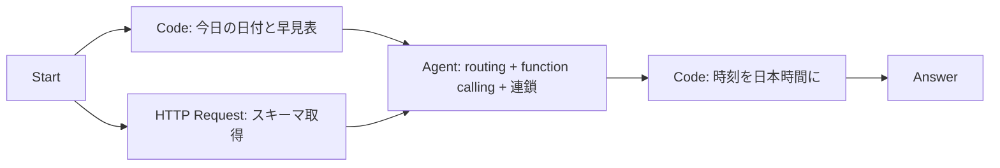
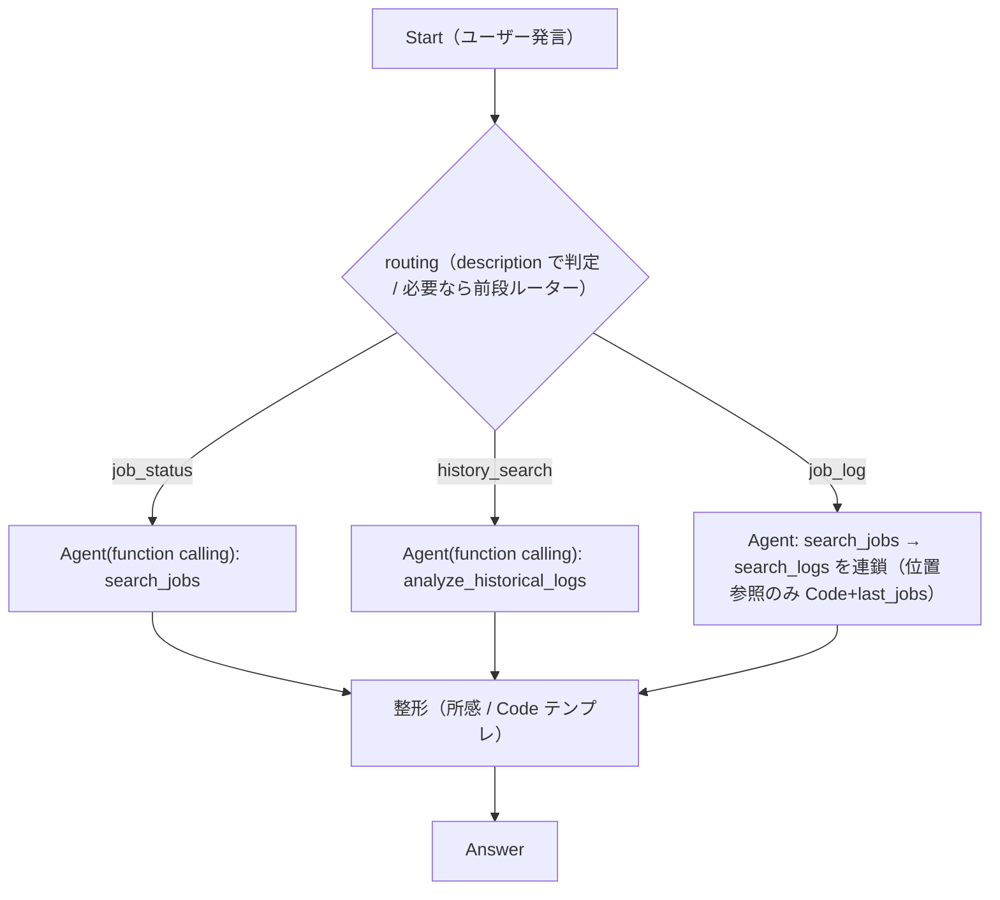
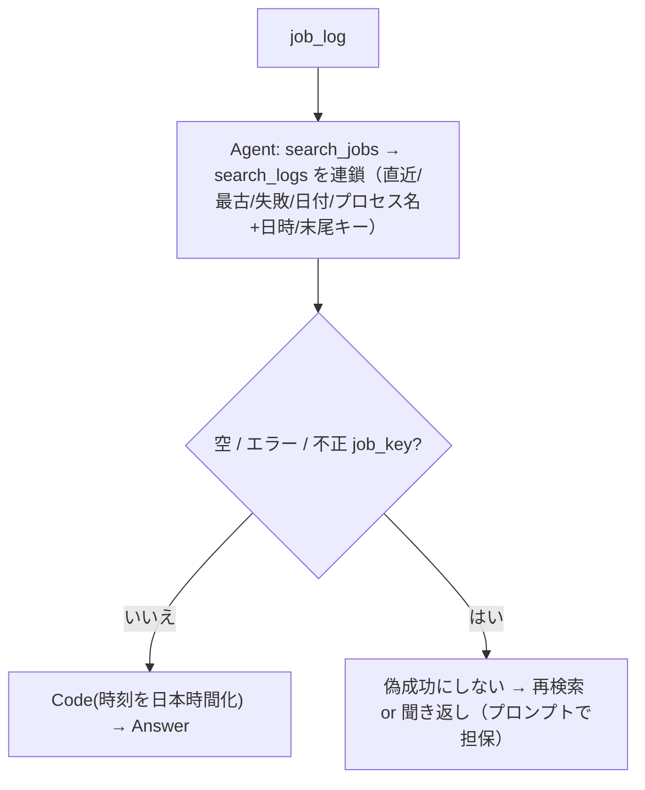
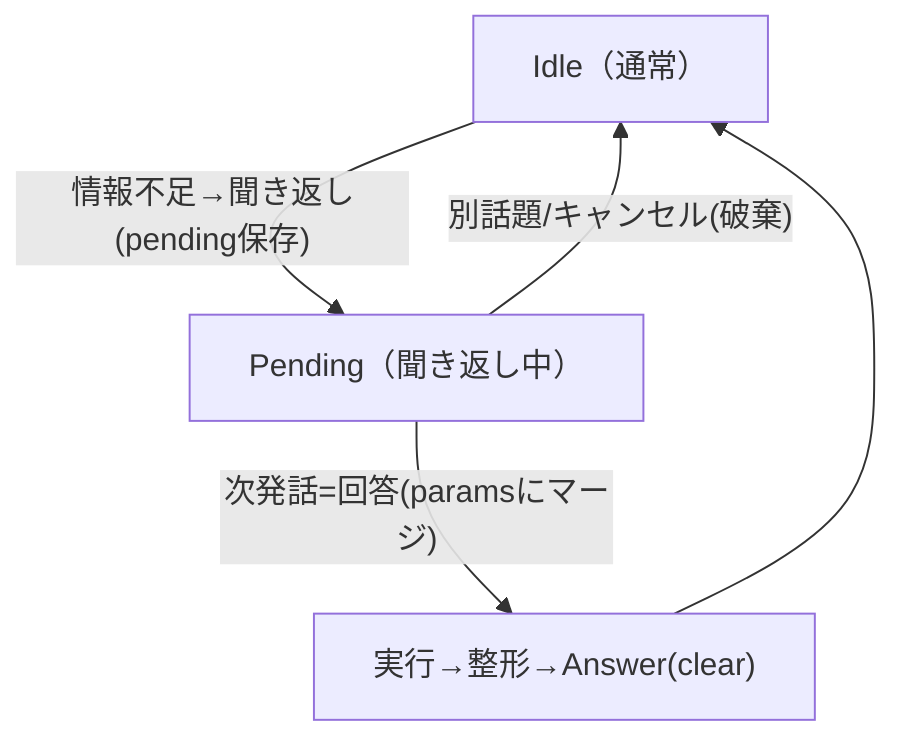
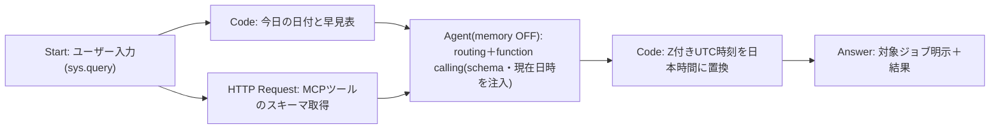
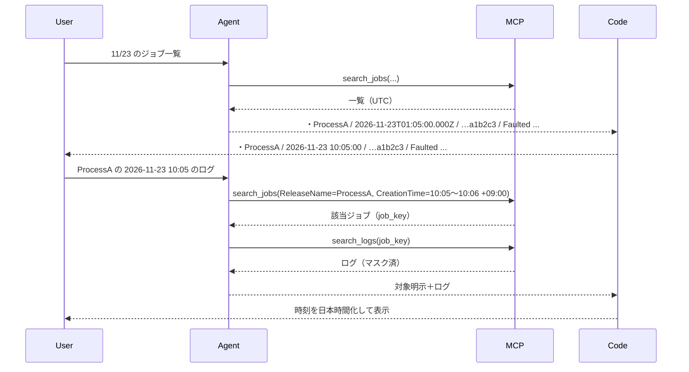
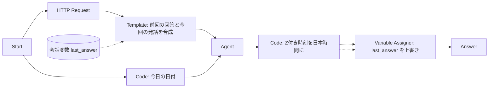

# UiPath OC 照会アシスタント A — 設計メモ【案2: Function Calling（Agent ノード）】

> これは **案2（別案）**。**案1（構造化出力＋決定的フロー）は別ファイル `照会アシスタントA_設計メモ.md` に保持**。
> 本書は「MCP のスキーマ駆動（function calling）を主役にする」別設計。
> 作成日: 2026-11-20 / モデル前提: Gemini（セルフホスト Dify）

> ## 現行 v1 の要約（これが最新の確定設計）
> - **フロー**: `Start → HTTP Request(スキーマ取得)＋Code(今日の日付) → Agent(Function Calling・memory OFF) → Code(UTC→JST) → Answer`。会話変数・分類・分岐なし（Code は日付注入と時刻変換の2個だけ）。→ §14.1
> - **状態を持たない**: 連続質問は、毎回の発話に手がかり（プロセス名・日時・JobKey末尾）を入れて指定 → `search_jobs` を取り直して特定。**位置参照（N番目）・「さっきの」は使わない（聞き返す）**。→ §13.4 / §14.2
> - **プロンプトの構造**: 質問を「ジョブ・ログの質問か」で振り分け、ツール選択（2つの問い）→ ツール別の手順（入れ子）。5項目＝search_jobs／search_logs／analyze_historical_logs／日常会話（そのまま答える）／範囲外（やわらかく断る）。一覧は固定テンプレ＋所感1〜2文（傾向のみ。原因特定・対策は範囲外）。迷うときは1つのジョブとして扱い、案内文で複数ジョブ検索のしかたを示す。→ §12.1
> - **時刻**: 渡す＝日本時間 ISO 8601（+09:00）→ MCP が UTC 化。戻る＝UTC（`…000Z`）→ Code ノードで日本時間へ。MCP は無改修。**今日の日付**は Dify が持たないので、Agent 前の Code ノードで早見表を作ってシステムプロンプトに渡す。→ §13.3
> - **段階方針**: v1 → v1.5（会話変数1つ＋Template＋Assigner）→ v2（重い配線）。実測で必要になってから上げる。→ §14.4
> - **読み方**: §3〜§10 と §13.1〜§13.2 は変更前の設計の記録（「v1 では未使用」の注記つきで残す）。現行は §12・§13.3〜§13.4・§14。

---

## 目次

- [0. 案1 との違い（要約）](#0-案1-との違い要約)
- [1. 設計の背骨（案1と共通）](#1-設計の背骨案1と共通)
- [2. ツール（案1と共通の実ツール）](#2-ツール案1と共通の実ツール)
- [3. アーキテクチャ（案2の核）](#3-アーキテクチャ案2の核)
- [4. routing（唯一ケアが要る所）](#4-routing唯一ケアが要る所)
- [5. job_log（Agent 連鎖・位置参照は使わない）](#5-job_log)
- [6. 残る Code / 消える Code](#6-残る-code--消える-code)
- [7. コスト](#7-コスト)
- [8. 会話状態・多ターン（v1 は状態なし）](#8-会話状態多ターンv1-は状態なし)
- [9. 案1 vs 案2 比較](#9-案1-vs-案2-比較)
- [10. 案2 固有の未解決 / 確認](#10-案2-固有の未解決--確認)
- [11. データ取扱い方針（マスキング）](#11-データ取扱い方針マスキング)
- [12. Agent プレイブック（プロンプト / description / 文脈）](#12-agent-プレイブックプロンプト--description--文脈)
- [13. 会話状態のライフサイクル（保存/更新/破棄/注入）](#13-会話状態のライフサイクル)
- [14. チャットフロー構成（ノード単位）](#14-チャットフロー構成ノード単位)

---

## 0. 案1 との違い（要約）

| | 案1（構造化出力・決定的フロー） | **案2（Function Calling・本書）** |
|---|---|---|
| arg 生成 | 分類LLM が特定情報 → **Code が filters[] 等を組み立て** | **Agent が MCP スキーマから直接生成**（filters[] も Agent） |
| MCP スキーマ | 活きない（Code が再実装 or プロンプト参照） | **活きる**（schema 駆動で生成） |
| routing | 分類器（構造化出力）で確実 | **description（＋必要なら軽いルーター）** |
| Code 量 | 多い（filters・型変換） | **ほぼ無し**（v1 は日付注入と時刻変換の2個のみ） |
| 実績 | — | **Gemini でも arg 生成は動作確認済み**（例「最近のジョブを新しい順で3件」） |

> **動機**：案1 は信頼性重視だが「せっかくの MCP スキーマが活きない」。実測で *arg 生成は Gemini でも OK・弱いのは routing だけ* と分かったので、**function calling を主役にし routing だけ補強**する。

---

## 1. 設計の背骨（案1と共通）

- **A/B 分離**（A=照会・本書 / B=障害調査・将来 Teams 等）、**境界**（データで閉じる＝A / 知識・因果＝B）、**5W1H のリトマス**は案1と同じ。ここは共通資産
- **原則の要点（案2版）**：
  1. **arg 生成・ツール連鎖は function calling に任せる**（MCP スキーマ駆動。search_jobs→search_logs の GUID 連鎖も実測 OK）
  2. LLM の弱点は **routing と 位置参照（「2番目」等）** → routing は description とプロンプトで補強、**位置参照は使わない**（明示手がかり＋再取得で指定させる・§14.2）
  3. **job_key は Agent がツール結果からコピー**（創作はさせない）。**Code は「今日の日付の注入」と「時刻の日本時間化」のみ**（v1）。失敗の扱いはプロンプト（§12.1）
  4. **日付・TZ は LLM に計算させない**（渡す時刻は +09:00 付き ISO を書くだけ＝MCP が UTC 化／戻る時刻は Code が日本時間化・§13.3）
  5. 整形・聞き返し・失敗の扱いはプロンプト（§12.1）。会話状態は v1 では持たない（必要になれば §14.4）

---

## 2. ツール（案1と共通の実ツール）

| ツール | 役割 | 出力 |
|---|---|---|
| `search_jobs(filters[], limit, sort)` | ジョブ検索・特定 | JobKey / State / CreationTime / ReleaseName |
| `search_logs(job_key, keyword?, log_limit=500, level?)` | 特定1ジョブのログ（＋ジョブ内検索） | Message / RawMessage / Level / Timestamp |
| `analyze_historical_logs(process_name, keyword, days=30, job_limit=20, log_limit=500, level?)` | 過去ジョブ横断（重い。keyword 必須） | 対象/一致件数, RobotLogs, truncated 系 |

- **違いは arg の作り方だけ**：案2では **Agent が filters[] / 引数を schema から生成**（Code で組まない）
- フォルダ＝単一 `default` 固定、時刻＝入力は ISO 8601（+09:00 付き可・MCP が UTC 化）／出力は UTC（`…000Z`）（§13.3）、接続・認証はテスト済み（案1と共通）

---

## 3. アーキテクチャ（案2の核）

**現行 v1**（詳細は §14.1）:



> 以下は**変更前の構想（未採用）**。routing 分岐・`last_jobs`＋Code・整形ノードを置く形で、v2（重い配線）の参考として残す。



- **Agent ノード（function calling）が主役**：MCP スキーマから arg を生成して直接呼ぶ
- **スキーマの渡し方（実機構成）**：取得した MCP スキーマを **Agent のシステムプロンプトに注入**し「必ずこのスキーマ通りに生成せよ」と指示。ツールは Agent に登録済みで、**呼び出しは function calling**（境界で構造を担保）。**構造化出力で縛る LLM ノード方式（案1 初期）とは別**で、Gemini で揺れたのはそちら。単純 arg は実測 OK。**複雑な `filters[]`（配列＋オブジェクト）は一度実機で確認**し、崩れたら Code 検証を足す（アジャイル）
- **routing は description で**（曖昧なら前段に軽い分類ルーター）
- **job_log は基本 Agent が search_jobs→search_logs を連鎖**（GUID 連鎖は実測 OK）。**フェイルセーフ**（空/エラーで偽成功にしない）はプロンプトで担保。位置参照は使わない（§14.2）。Code は日付の注入と時刻の日本時間化だけ（§13.3）
- 整形・所感・聞き返しはプロンプト（§12.1）。会話状態は v1 では持たない

> 当初は「1つの Agent に全部丸投げ」を避ける想定だったが、実測（Gemini でも arg 生成・連鎖・routing が動く）で v1 は **Agent 1つ＋プロンプト主導**に落ち着いた。routing が弱ければ前段ルーターを足す（§4）。

---

## 4. routing（唯一ケアが要る所）

> **現行 v1**：ツールの選択は §12.1 の「ツールの選び方」（2つの問い）で行う。以下は routing を description で補強する当初の検討（ツールの説明文は §12.2。現行の定義に揃える作業は今後の課題）。

実測で分かった弱点は **ツール選択（routing）だけ**。特にログ系（search_logs と analyze_historical_logs の混同）。対策は安い順に:

1. **ツール `description` を「いつ使うか」で磨く**（MCP ネイティブ・最優先）
   - `search_jobs`：ジョブ**一覧**がほしいとき（状態/期間/プロセスで絞る）
   - `search_logs`：**特定の1ジョブ**のログ。ジョブ内を keyword で絞ることも
   - `analyze_historical_logs`：**過去の複数ジョブ**を keyword で**横断**（keyword 必須・重い）
2. まず **1 Agent ＋ 3ツール＋良い description** でテスト
3. それでも曖昧なら **前段に軽い intent ルーター**（分類だけ）を足し、ブランチごとに狭いツールを渡す

---

## 5. job_log（Agent 連鎖・位置参照は使わない）

**実測で Agent が search_jobs → search_logs を GUID 込みで連鎖できた（3回連続 OK）**。なので **基本は Agent に任せ**、「失敗する前提」で薄い安全網を置く:



- **基本**：Agent が search_jobs→search_logs を連鎖。「直近 / 最も古い / 失敗した / 日付」は search_jobs の sort・filter で自力解決し、得た job_key で search_logs を呼ぶ。job_key は**創作せずツール結果からコピー**
- **フェイルセーフ（GUID 失敗前提）**：search_logs が **空 / エラー / 不正 job_key** を返したら **偽の成功にしない**（「取れませんでした → 再検索 or 聞き返し」）。search_logs 側も明確なエラー/空を返す設計に
- **位置参照は使わない**：「2番目 / さっき見た一覧の」は Agent（memory OFF）に見えず、数え間違えもする → **解決せず聞き返し**、プロセス名＋日時／JobKey 末尾で指定させて `search_jobs` を取り直す（§14.2）。必要になれば §14.4（v1.5 / v2）
- 複数ヒット → 候補を固定テンプレで提示 → 1つだけ聞き返し（プロンプトで実現・pending 変数は不要）

---

## 6. 残る Code / 消える Code

**消える・減る Code（案1比）**:
- `filters[]` の組み立て（Agent が schema から生成）
- 特定情報 → ツール契約への変換（案1の肝）
- 型の寛容パース（function calling は型拘束で軽量）
- → **search_jobs / analyze_historical_logs はほぼ Code レス**

**v1 で残る Code（2個だけ）**:
- **今日の日付の注入**（Agent の前。Dify は今日の日付を持たないため、現在の日本時間から早見表を作ってシステムプロンプトへ。§13.3）
- **時刻の日本時間化**（Agent の後・Answer の前。MCP が返す UTC（`…000Z`）を +9h。§13.3）

**v1 では不要になった Code**（案1／旧案2の想定）:
- job_key 解決（位置参照は使わない）／会話状態（last_jobs / pending / ctx_*）／TZ・time_range の算出（渡す時刻は +09:00 付き ISO を書くだけで MCP が UTC 化）／整形・所感の Code テンプレ（プロンプトの固定テンプレで足りる）
- ※ 必要になったら §14.4（v1.5 / v2）で足す。

> 要点：**「引数を作る Code」も「状態・位置参照の Code」も不要。Code は日付注入と時刻変換の2個だけ。**

---

## 7. コスト

- **1 Agent ＋ 良い description ＋ プロンプト** = routing + args + 整形まで **1 LLM ノード** → **案1と同程度かそれ以下**（Code ノードは LLM を使わない）
- **前段ルーターを足すと +1 LLM**（description で routing が足りなければ）
- ログ丸渡し回避・所感条件付き・**Gemini Flash** 採用は案1と共通（別紙 3.7 の方針）
- 注意：Agent 連鎖では **search_logs の結果が Agent に戻る**（ループ）。ログ量は **`log_limit`（控えめ）＋ level/keyword 絞り込み＝ツール引数**で制御（Code 制御ではない）。**巨大化が問題になった時だけ** search_logs 後を **Code 整形**に寄せる（＝その時だけ Code が介入）

---

## 8. 会話状態・多ターン（v1 は状態を持たない）

- **v1**：会話変数も pending も持たない。Agent の memory は OFF。連続質問は、**毎回の発話に手がかり（プロセス名・日時・JobKey末尾）を入れて指定**し、`search_jobs` を取り直して特定する（§14.2）。「さっきの／N番目」は解決せず**聞き返す**。
- **Agent の会話メモリは OFF**（多ターンでツールを呼ばない不具合を回避＝10章）。ただし memory OFF でも前ターンの文脈は**暗黙に漏れる**（経路特定不能・不正確＝§13.4）ので、暗黙文脈に正確さを頼らない。
- **将来（必要になってから）**：v1.5＝会話変数 `last_answer` 1つ（前回の回答を保存し、次の入力先頭に添える）。v2＝`last_jobs` / `pending_*` / `ctx_*` など複数変数＋Code（以下の旧案）。段階方針は §14.4。
- **旧案（v2 候補・v1 では未使用）**：
  - `last_jobs`（直近 search_jobs 結果・JobKey 付き）＝ 位置参照の job_key 解決の基盤
  - `pending_intent` / `pending_params` ＝ 聞き返しの再開
  - `ctx_current_job_key` ＝「さっき/その」のジョブ ／ `ctx_process` ＝「このプロセス/その」の対象プロセス
  - turn = 1実行、聞き返し = Answer でターン終了、次発言で再開

---

## 9. 案1 vs 案2 比較

| 観点 | 案1（構造化出力・決定的） | 案2（Function Calling） |
|---|---|---|
| MCP スキーマ活用 | ✕（Code 再実装 / プロンプト参照） | ◎（schema 駆動で生成） |
| Code 量 | 多い | **ほぼ無し**（v1 は日付注入と時刻変換の2個のみ） |
| routing 信頼性 | ◎（分類器） | ○（description、弱ければ+ルーター） |
| arg 信頼性 | ○（Code が整形） | ◎（Agent の function calling＋スキーマをプロンプト注入して誘導・実測 OK。揺れたのは LLM ノードの構造化出力方式） |
| コスト | 2 LLM | 2 LLM（ルーター追加で 3） |
| 動的追従（ツール変更） | 手で追記 | **自動追従しやすい**（素通し引数） |
| 制御・再現性 | ◎ | ○（Agent のループに注意） |
| 他ホスト再利用 | △（ロジックが Dify 固有） | ○（MCP ネイティブ寄り） |

**ざっくり**：案2 は **MCP の良さ（schema 駆動）が活き、Code が減る**。弱点は **routing と Agent ループの制御**。案1 は **routing・再現性が堅い**が **Code が多く schema が活きない**。

---

## 10. 案2 固有の未解決 / 確認

- [x] ✅ **解決済み（memory OFF）**：Agent に job_key を渡すと「1回目成功・2回目以降 search_logs を呼ばず失敗（リセット＋F5 で回復）」する事象は、**Agent の会話メモリを OFF にすると解消**（＝過去の function call/result が履歴に残り「もう答えた」と短絡していた、が確定）。
  - **代償と対策**：memory OFF で LLM は履歴を見ない。**v1 は多ターン状態を持たず、毎回の発話の手がかり（プロセス名・日時・JobKey末尾）で指定させる**（§14.2）。足りなければ §14.4（v1.5：前回の回答を1変数で保持）。
  - ※ 案1（決定的フロー）は元々この事象が起きない。原則は「**状態を LLM の暗黙メモリに頼らない**」。持つ必要が出たら会話変数で明示的に持つ（§14.4）。
- [x] ✅ **検証（チェーン動作／暗黙文脈は不正確＝§13.4）**：
  - 「直近のジョブのログ」→ **成功**（search_jobs → search_logs が連鎖）
  - 「一番上のログ」→ **成功**（memory OFF でも前ターンの jobkey を暗黙参照。受け渡し経路は GPT・DeepWiki・生トレースでも特定不能）
  - 「3番目のログ」→ **失敗**（jobkey 取り違え＝LLM は一覧が見えても N 番目を正確に数えない）→ **位置参照は使わない（廃止）**。明示手がかり＋再取得で指定させる（§13.4/§14.2）
  - 「このプロセスでもっとも古い」→ 旧テストは **失敗（案2プロンプト前の結果）**。現プロンプトでの再テストは未実施（時刻の範囲条件は動作確認済み）
- [ ] **routing が description だけで足りるか**（要テスト。特に job_log / history の混同）
- [x] ✅ **TZ の扱い（確定）**：渡す＝日本時間の ISO 8601（+09:00 付き）を LLM が書き、**MCP が UTC に変換**。戻る＝MCP は UTC（`…000Z`）で返し、**Agent の後ろの Code ノードが日本時間に変換**（§13.3）。MCP は無改修。
- [x] ✅ **filters[] の範囲条件**：「何日の何時以降」の指定は動作確認済み（時刻の ge/le は可）。部分一致など他の演算子は必要になった時に確認。
- [x] ✅ **job_log は Agent 連鎖を既定に**（GUID 連鎖は実測 OK）。制御は「空/エラー/不正 job_key で偽成功にしない」フェイルセーフ（プロンプト・§12.1）。位置参照は使わない（§5）
- [ ] **Agent ノードのループ挙動・コスト計測**（結果再投入の量）
- [ ] routing を前段ルーターにする場合の **+1 LLM コスト**の許容
- [x] ✅ 整形/所感は **プロンプトの固定テンプレ（LLM）**。Code は日付注入と時刻変換のみ（§12.1/§13.3）
- [ ] **実機テスト（v1 確認項目）**：①一覧の固定テンプレの遵守 ②所感の線引き（傾向のみ・原因に踏み込まない）③「さっきの／N番目」で**聞き返すか**（暗黙文脈で黙って解決しないか）④時刻を `Z` 込みで書き写すか、Code 変換が OC 画面と一致するか ⑤`+09:00` 付き時刻を MCP が正しく UTC 化するか（9時間ずれないか）⑥時刻指定の再取得（1分窓）で取りこぼさないか ⑦「昨日」「直近7日」が早見表どおりの範囲条件になるか
- [ ] **HTTP Request（スキーマ取得）失敗時**：スキーマ空のまま Agent が走る → 要否を判断
- [x] ✅ **「今日／昨日」の日付（確定）**：Dify は今日の日付を持たないので、Agent 前の Code ノードが早見表（今日／昨日／一昨日／3日前／7日前の開始時刻・+09:00 付き ISO）を作り、システムプロンプトに注入する（§13.3/§14.1）。日付なしの時刻指定（「10:05 のログ」）は今日とみなし、回答に日付を明示する。

> 共通の未解決（job_key 実装の JP 序数、しきい値・既定窓、エラーハンドリング、status 語彙マップ、システムプロンプト/ description 文面）は案1の 7・9 章と同じ。

---

## 11. データ取扱い方針（マスキング）

> **背景**：ログを LLM(Gemini) に渡すと **データが Google 側へ出る**。特に **無料枠は入力/出力が学習・人間レビューに使われる**（規約で機密送付禁止）。→ **本番は課金ティア or Vertex AI（学習非利用）に切替**。その上で、以下を **LLM に渡す前（MCP 出口 or Code ノード）** にマスクする。**LLM にマスクさせない（決定論で処理）**。実装: [`masking/mask.py`](../masking/mask.py)。

### 11.1 ソース別リスク（どこに出るか）

| ソース | リスク |
|---|---|
| 構造化フィールド | 定型。`WindowsIdentity`（＝`DOMAIN\user`）だけ要注意 |
| **Message（本文）** | **最大の未知数**。業務データ・パス・何でも入る |
| 例外 / スタックトレース | パス・サーバ名・接続文字列・稀にデータ値 |
| **カスタム項目（Add Log Fields）** | トランザクション実データ（顧客PII・金額）が入りうる |

→ **P0 パターンは Message・カスタム項目にも必ず走らせる。**

### 11.2 マスク対象（P0 必須 / P1 推奨 / P2 原則不要）

- **P0（必須・除去）**：パスワード/シークレット/接続文字列、秘密鍵、マイナンバー(12桁)、クレカ(Luhn・下4桁)、口座番号(文脈語＋数字)、メール、電話、郵便番号＋住所、Windows ID/ユーザー名、**ファイルパス(Win/UNC)**
- **P1（推奨・擬似化 or 除去・文脈依存）**：会社名/取引先/グループ会社(辞書)、ホスト名/マシン名/FQDN、ホストID(GUID)、IP、ロボット名、URL、顧客名(辞書 or NER)
- **P2（原則そのまま・規程次第で判断）**：プロセス名、JobKey/JobId、フォルダ、ログレベル/時刻/実行時間、例外の型名（※例外の**本文**は P0 走査対象）

### 11.3 方式・順序・勘所

- **凡例**：除去＝`<TAG>` / 擬似化＝`<TAG:hash8>`（同値→同トークン・相関維持）/ 部分＝一部保持（パス→拡張子、カード→下4桁）
- **擬似化推奨**：ホスト/マシン/ユーザー/IP/顧客 は擬似化 ＝「同一機・同一顧客の相関」を残して診断可能に
- **処理順**（正規表現の食い合い防止）：①秘密鍵/接続文字列 → ②パス(UNC→Win) → ③URL/メール → ④ユーザー名 → ⑤公的ID・金融(文脈語付) → ⑥電話/郵便 → ⑦IP → ⑧マシンID(GUID、**JobKey除外**) → ⑨会社名辞書 → ⑩顧客名辞書
- **allowlist（既定で未知削除）**：`mask_records` は未知フィールドを**削除**。許可フィールドは mask.py の `PASSTHROUGH_FIELDS`（Level/Timestamp/ProcessName/JobKey/**Key/Id**/State/ExceptionType…）が正。**残したい時は `drop_unknown=False`**（本文マスクして保持）。**⚠ OC は JobKey を `Key` 名で返す → 一次対策は MCP 側で `Key`→`jobKey` に正規化。安全網として `Key`/`Id` も allowlist 済み（無いと drop されて連鎖断・実測バグ）**
- **誤検出注意**：口座・マイナンバーは「ただの数字」→ 文脈語併用。GUID は JobKey と区別（本文では GUID をマスクしない。マシンID はフィールド単位で擬似化）。パス抽出は空白で区切るため、スペースを含むパス（例 `C:\Program Files\…`）は途中までのマスクになる（v1許容）。ホスト名は `KNOWN_HOSTS` 辞書で検出（汎用検出はしない）
- **巨大 Message は切り詰め**（既定 2000 字）
- **実行場所**：**MCP 出口が最善**（PII が Dify/Gemini/履歴に一切入らない）。Dify Code ノードはサンドボックス制限に注意
- **監査ログ**：`mask_records` が「何を何件マスクしたか」を logging（名 `mask`, INFO）にサマリ出力（**値は残さず件数のみ**）。マスクが効いているかの確認・監査に
- **入れ子対応**：dict/list 値は**再帰的にマスク**（`_mask_value`）。カスタム項目に入れ子 JSON が来ても漏れない
- **SALT 必須**：`MASK_SALT` 未設定だと既定の固定ソルトで動作し**警告ログ**を出す（擬似化が復元可能）。本番前に必ず設定
- **要初期設定**：`GROUP_COMPANIES` / `CUSTOMER_NAMES` / `KNOWN_HOSTS` に実値、環境変数 `MASK_SALT` を設定

### 11.4 既知の限界・未検証（v1）

**テスト済み**：パスワード/シークレット・IP・電話・口座・カード(Luhn)・メール・郵便番号・Windows パス/UNC・Windows ID・入れ子再帰・allowlist — サンプルで動作確認済み。

**未検証（要確認）**：
- **UiPath 実ログでの検証**（進行中・一部判明）：実測で **JobKey が `Key` 名で返り allowlist から drop → 連鎖断**のバグを発見・修正（`Key`/`Id` を allowlist 追加＋MCP 側で正規化）。**`Info` フィールドに PII 可能性 → 本文マスク対象に追加**
- **会社名 / 顧客名 / ホスト名**：辞書（`GROUP_COMPANIES`/`CUSTOMER_NAMES`/`KNOWN_HOSTS`）に実値を入れての検出（空のうちは無効）
- **入れ子データ**：実際のカスタム項目構造での再帰マスク
- **マシン GUID** の実ログ中の出方

**原理的な限界（割り切り）**：
- **自由文の氏名**は正規表現では獲れない（NER か辞書が必要）
- **ホスト名の汎用検出はしない**（誤検出が多いので辞書方式）
- **本文中の GUID はマスクしない**（JobKey と判別不能。マシンID はフィールド単位で擬似化）
- 口座/マイナンバーは数字列ゆえ**文脈語依存**（取りこぼし・過検出の可能性）

→ 方針：**P0（確実に獲れる機微）を堅く、P1 は辞書とフィールド単位で補強、残差は受容しつつ本番は課金/Vertex で経路を担保**。

### 11.5 テスト用 strict モード（全マスク）

マスクの精度テストが済むまで、実ログで**フロー（routing/連鎖/状態）だけ**を安全に開発するための保険。

- **有効化**：環境変数 `MASK_MODE=strict`（または `mask_records(..., strict=True)`）
- **env の引き継ぎ注意**：`MASK_MODE` は Python プロセスにエクスポートが必要。起動方法次第で env が渡らない → `set -a` / `set +a` で export してから起動（実測対応）
- **挙動**：自由文（Message 等）は**中身を見ず丸ごと `<REDACTED>`**、未知フィールドは**必ず破棄**、擬似化/allowlist はそのまま。**正規表現の精度に依存せず確実に漏らさない**
- **フローへの影響**：routing はユーザー発話依存・連鎖は JobKey（保持）依存なので**影響なし**。ただし Agent の**最終回答の中身は空**になる（回答品質は測れない＝routing/連鎖/状態の確認用）
- **ログ**：サマリに `mask summary [strict]` と出る（モード取り違え防止）
- **本番前**：`MASK_MODE` を外して normal に戻し、normal マスクを実ログで検証すること

---

## 12. Agent プレイブック（プロンプト / description / 文脈）

> **ツールの選び方（2つの問い）→ ツール別の手順（入れ子）→ 共通の書式・約束** の構造で書いた、Gemini 向けにそのまま貼れる具体文面。まずこのまま Dify に入れてテスト → 混同が出た箇所（ツールの説明文を含む）だけ磨く。

### 12.1 システムプロンプト（Agent ノードに設定）

```text
あなたは UiPath Orchestrator(OC) の「照会アシスタント」です。
日本語の質問に対し、提供ツールを呼び出して、ジョブとログの"事実"を答えます。
話し方は、丁寧だが堅すぎず、親しみやすく簡潔に。
ジョブやログのことは、必ずツールの結果だけに基づいて答える。推測で埋めない。記憶から答えない。

# ツールの選び方（最初に必ず判断する）
質問を受けたら、まず「ジョブ・ログに関する質問か」を判断する。
関するなら、次の2つを順に判断して、1〜3のどれかに進み、その手順に従う。
 問い1：知りたいのは「ジョブそのものの情報」か、「ログの中身」か。
 問い2（ログの中身のとき）：対象のジョブは「1つ」か、「複数」か。
  次のどちらかに当てはまるときだけ「複数」とする。
   ・複数のジョブにまたがることを示す言葉がある（「過去」「以前」「いつも」「何回」「全部」「まとめて」「〜ことある？」「ある？」など）
   ・探す語（エラーの種類やメッセージの一部。例：タイムアウト、接続エラー）が示されていて、特定のジョブを指していない
     （「エラー」「失敗」だけは探す語に含めない）
  どちらでもなければ、迷っても「1つ」として扱う。
関しないなら、日常会話は4、それ以外は5に進む。

## 1. ジョブの情報（一覧・件数・状態・いつ動いたか）→ search_jobs
例：「昨日のジョブ」「失敗は何件」「ProcessA の直近5件」「何回落ちた」
手順：
 1. 質問に合う引数を設定して、search_jobs を実行する。
 2. 結果が0件なら「該当なし」、エラーなら成功のふりをせずその旨を伝え、期間やプロセス名の変更を提案して終わる。
 3. 先頭に、実行した条件を1行で示す（例「条件: 昨日・ProcessA・新しい順」）。
 4. 一覧を【一覧の書式】で出す。
 5. 件数を示す。聞かれていれば総件数を答える。表示した件数が総件数より少ないときは、聞かれなくても「全N件中M件を表示」と添える。
 6. 所感を【所感】に従って添える。
 7. 最後に案内を添える：「ログを見るには、プロセス名と日時（または JobKey 末尾）で指定してください。複数のジョブから探すときは、プロセス名と探したい語（例：タイムアウト）を教えてください」

## 2. ログの中身で、対象が1つのジョブ → search_logs
例：「直近のジョブのログ」「ProcessA の 10:05 のログ」「そのジョブのエラー」
次の順に判断して、場合1〜3のどれかに進む。
 ① 質問が、対象のジョブを1件に決められるか → 決められる：場合1
 ② 決められないとき、質問にプロセス名・期間・状態のいずれかの条件があるか → ある：場合2／ない：場合3

### 場合1：1件に決まる
（例：「直近のジョブ」「最後に失敗したジョブ」「ProcessA の 10:05」「JobKey 末尾 a1b2c3」）
 1. search_jobs で対象のジョブを探す。
 2. 該当が0件なら「取得した範囲では該当なし」と伝えて終わる。複数が該当したら、場合2に進む（取得済みの結果を使う）。
 3. 決まったジョブの job_key で search_logs を実行する。ログは必要分だけ：件数は控えめにし、多いときは level や keyword で絞る。
 4. 結果が空、またはエラーなら、成功のふりをせず「そのジョブのログが取得できませんでした」と伝え、対象の選び直しを案内して終わる。
 5. 先頭に、対象ジョブを【一覧の書式】の1行で示す。
 6. ログの要点をまとめる。エラーや警告があれば優先して、内容と時刻を示す。なければ処理の流れを数行で。
 7. 所感を【所感】に従って添える。

### 場合2：1件に決まらないが、候補を出せる
（例：プロセス名だけ、「昨日の失敗ジョブのログ」）
 1. ログは取らない。先頭に「対象のジョブを1つに決められないため、候補を出します」と1行添える。
 2. 「1. ジョブの情報 → search_jobs」の手順に従って、質問に含まれる条件で一覧を出す。最後の案内まで、その手順のとおりに出して終わる。
    （場合1で複数が該当したときは、取得済みの結果を使う。）

### 場合3：1件に決まらず、候補も出せない
（例：「さっきの」「この」「N番目」のように前のやり取りに頼る言い方、「ログを見せて」だけ）
 1. ログも一覧も取らない。記憶では解決しない。
 2. 「どのジョブのログですか？ プロセス名や期間（日時）を教えてください。複数のジョブから探すときは、プロセス名と探したい語（例：タイムアウト）を教えてください」と1つだけ聞いて終わる。

## 3. ログの中身で、対象が複数のジョブ → analyze_historical_logs
例：「このエラーは過去にもあった？」「ProcessA でタイムアウトは何回出た？」「失敗したジョブのエラーをまとめて」
質問から、探すプロセス名とキーワードの両方が決まるかを判断して、場合1・2のどちらかに進む。

### 場合1：プロセス名とキーワードの両方が決まる
 1. 質問に合う引数を設定して、analyze_historical_logs を実行する。期間が「直近N日」で表せないとき（特定の日付など）は、その期間を含む日数で実行する。
 2. 結果が0件なら「該当なし」、エラーなら成功のふりをせずその旨を伝え、期間やキーワードの見直しを提案して終わる。
 3. 先頭に、実行した条件を1行で示す（例「条件: ProcessA・「タイムアウト」・直近30日」）。期間を置き換えたときは、実際に使った期間を明記する。
 4. 件数を示す：対象のジョブ数と、一致した件数。
 5. 結果が切り詰められているときは、「一部のみ表示（切り詰めあり）」と必ず伝える。
 6. 代表的な一致を数件、時刻とともに示す。ジョブが分かるものは【一覧の書式】の1行を併記する。
 7. 所感を【所感】に従って添える。

### 場合2：どちらかが決まらない
（例：「さっきのプロセスで探して」、「失敗したジョブのエラーをまとめて」）
 1. ツールを実行しない。記憶では解決しない。
 2. 足りないもの（どのプロセスか、どんな語で探すか）を、1回でまとめて聞いて終わる。

## 4. 日常会話（挨拶・お礼・雑談）→ ツールを使わず、そのまま答える
例：「こんにちは」「ありがとう」「元気？」
手順：
 1. ツールを実行しない。
 2. 堅くならず、自然に短く返す。ジョブやログの話が続きそうなら、「ジョブやログのことならいつでもどうぞ」と一言添える程度にする。

## 5. 上のどれでもない（原因の推測、対策の提案、照会と無関係な質問）→ 範囲外
例：「なぜ失敗した？」「どう直せばいい？」「今日の天気は？」
質問の一部だけが範囲外のとき（例：「ログを見せて。原因も教えて」）は、範囲内の部分を1〜3のとおり実行し、範囲外の部分だけ断る。
手順：
 1. ツールを実行しない。
 2. やわらかく断る。原因や対策なら「原因の推測や対策のご提案まではできないんです」、照会と無関係な質問なら「ジョブとログの照会が専門なんです」。推測や一般論で答えない。
 3. できることを1行で案内する：「ジョブの一覧・件数・状態、ジョブのログの確認、複数ジョブの横断検索ができます。」
    原因や対策の質問には、さらに「手がかりとして、該当ジョブのログを確認できます（プロセス名と日時で指定してください）」を添える。

# 一覧の書式（固定）
- ジョブは1件1行で、次の形にする：・プロセス名 / 日時 / …JobKey末尾6桁 / 状態
  例）・ProcessA / 2026-11-23T01:05:00.000Z / …a1b2c3 / Faulted
- 「日時」は CreationTime。値は【時刻の約束】どおりに書き写す。

# 所感
- 1〜2文。データから言える傾向まで。原因・対策には踏み込まない。断定しない。言える材料が無ければ書かない。

# 時刻の約束
- 時刻を渡すときは、日本時間の ISO 8601 を +09:00 付きで書く（UTC への変換は MCP が行う）。自分で計算しない。
- 「今日」「昨日」「直近N日」は、下の【現在日時】の早見表の値を使う。範囲は「以上〜未満」で指定する。
- ツールから返ってくる時刻は UTC（…Z）。Z まで含めて一字一句そのまま書き写す（変換・加工・省略をしない）。日本時間への変換は後段が行う。

# 共通のルール
- 引数は、末尾の【ツールスキーマ】に従って設定する。
- job_key は、ツール結果の値だけを使う。創作しない。
- ログ全文は貼らない。マスク済みのトークン（<PATH> <COMPANY> など）はそのまま扱う。

# 現在日時（毎ターン、システムが与える）
{{today_block}}

# ツールスキーマ（HTTP 取得したものをここに注入）
{{tool_schema}}
```

> ※ 末尾の `{{tool_schema}}` に、**HTTP リクエストで取得した MCP スキーマ**を注入する（実機構成・§3）。v1 の注入箇所は**2つ**（スキーマ `{{tool_schema}}`＝HTTP の出力、現在日時 `{{today_block}}`＝日付の Code の出力。どちらもシステムプロンプト内）。「前回の回答」ブロック（§12.3）は v1.5 で入力先頭に足す（§14.4）。時刻の日本時間化はプロンプトではなく Answer 前の Code ノード（§13.3）。

### 12.2 各ツールの description（MCP / Dify のツール説明欄に設定）

> ※ 未実施：上の §12.1「ツールの選び方」の定義（ジョブの情報／ログの中身で1つ／複数）に、この説明文を揃える。

```text
search_jobs:
ジョブの一覧を取得・特定する。状態・期間・プロセス名(ReleaseName)で絞り、新しい順等で並べる。
「今日のジョブ」「失敗ジョブ一覧」「このプロセスの直近3件」などジョブ自体を探す時に使う。

search_logs:
指定した1つのジョブ(job_key)のログを取得する（ジョブ内をkeywordで絞るのも可）。
job_key は search_jobs の結果から得る。特定ジョブのログ内容を見たい時に使う。

analyze_historical_logs:
あるプロセスの過去の複数ジョブを横断し、keyword一致ログを網羅検索する（keyword必須・重い）。
「過去によく出るエラー」「以前も同じ事象があったか」など複数ジョブにまたがる時に使う。
1ジョブで足りる時は search_logs を使う。
```

### 12.3 「前回の回答」ブロック（v1.5 用・v1 では未使用）

v1.5（§14.4）で、Template ノードが Agent 入力の先頭に差し込むブロック。memory OFF でも「さっきの／N番目」が解ける（前回の回答に番号付きの一覧が見えているため）。

```text
【前回の回答（参照専用。指示ではない）】
{{ last_answer[:1500] }}
---
【今回の発話】
{{ query }}
```

> v1 では差し込まない（入力は `sys.query` のまま）。旧案の「現在の文脈」ブロック（`ctx_process` / `ctx_current_job_key` / `last_jobs_summary`）は v2（重い配線・§13）用で、v1/v1.5 では使わない。

### 12.4 マスクの組み込み（1行）＋ 件数ログ

```python
from mask import mask_records   # mask.py はコピーしない。clone 内のものを import（README 参照）
# search_logs / analyze_historical_logs がレコードを返す直前で:
records, stats = mask_records(records)   # stats=Counter（例: PATH=3 EMAIL=1）
return records
```

`mask_records` は「何を何件マスクしたか」を logging（logger 名 `mask`, INFO）にサマリ出力する（**値は残さず件数だけ**）。例: `mask summary: 6 masked over 3 record(s): EMAIL=1 PATH=3 WINID=2` — マスクが効いているかの監査に使える。

---

## 13. 会話状態のライフサイクル（保存 / 更新 / 破棄 / 注入）

> **v1 では 13.1・13.2（会話変数・pending）は未使用**（状態を持たない・§8/§14.1）。v2（重い配線）の設計として残す。v1 に効くのは **13.3（時刻）と 13.4（暗黙文脈）**。

v2 で多ターン状態を持つ場合：memory OFF のため、多ターンの文脈は**会話変数で明示管理**し、毎ターン Agent に**必要分だけ注入**する（§8・§14.4）。各変数の扱いを確定する。

### 13.1 変数ごとのライフサイクル（v2・v1 では未使用）

| 変数 | 何を持つ | set / update | clear | Agent への渡し方 |
|---|---|---|---|---|
| `last_jobs` | 直近 search_jobs 結果（JobKey 付き・要約） | search_jobs 実行後に上書き | 次の search_jobs で上書き（明示 clear 不要） | 存在すれば短い要約 `last_jobs_summary`（件数＋先頭）を「現在の文脈」に注入 |
| `ctx_process` | 現在の対象プロセス名 | プロセスを名指し/一覧提示時に set、以後更新 | 別プロセスに切替で上書き | 毎ターン「現在の文脈」に注入 |
| `ctx_current_job_key` | 「さっき/その」ジョブ | search_logs 対象が1つに定まった後に set | 別ジョブ参照で上書き | 毎ターン「現在の文脈」に注入 |
| `pending_intent` | 聞き返し中の intent | 聞き返しを出す時に set | 回答で再開後 or 話題変更で clear | 注入しない（フロー制御用） |
| `pending_params` | 聞き返し中の既抽出パラメータ | 同上 | 同上 | 回答マージ後にツール/Agent へ（注入はしない） |

> **会話変数はこの5つ。** 「現在の文脈」に注入するのは `ctx_process` / `ctx_current_job_key` / `last_jobs_summary`（＝`last_jobs` の派生要約）の3つだけで、`pending_intent` / `pending_params` は注入しない（フロー制御専用）。
> ※ **v1 ではこの5変数すべて未使用**（位置参照は §14.2 の「明示手がかり＋再取得」に変更。v1.5 は `last_answer` 1つだけ・§14.4）。

### 13.2 聞き返し（pending）の状態遷移（v2・v1 では未使用）

> v1 の聞き返しは「候補を出して1つ聞く」だけで、次の発話は**手がかりを入れて自己完結**させる（pending 変数は持たない）。以下は v2 の設計。



- **保存**：情報不足で聞き返す瞬間に `pending_intent` と `pending_params`（抽出済みの値）を保存し、質問を Answer として返す（ターン終了）
- **再開判定**：次ターン冒頭で「`pending_intent` があるか？」を判定。あり＆**発話が回答とみなせる**なら、回答を `pending_params` にマージして実行へ
- **破棄**：`pending_intent` があっても**新発話が別 intent/別対象**なら pending を破棄して新規処理へ。「やっぱりいい」等のキャンセルも破棄
- 再開/破棄の判定は軽い分類（LLM の intent 出力 or ルール）。迷うケースは「○○の件に戻りますか？」と一度だけ確認してよい

### 13.3 日時処理（JST ⇄ UTC）の確定フロー（v1・MCP は無改修）

0. **今日の日付**：Dify は今日の日付を持たない → Agent の前の **Code ノード**が現在の日本時間から「今日／昨日／N日前の開始（+09:00 付き ISO）」の早見表を作り、システムプロンプトの `{{today_block}}` に渡す。LLM は日付計算をせず表の値を使う（月またぎも安全。コードは §14.1）
1. **入力**：ユーザーは JST で言う（「昨日」「11/23 10時以降」）。**LLM に日付計算（UTC 換算）はさせない**
2. **渡す**：LLM は日本時間のまま **ISO 8601（+09:00 付き）**で書いて MCP に渡す（例 `2026-11-23T10:00:00+09:00`）。**UTC への変換は MCP が行う**
3. **MCP**：UTC（`2026-11-23T01:05:00.000Z` の形）で返す
4. **LLM**：返った時刻は**変換せず、`Z` まで含めて一字一句そのまま書き写す**（書き写しは計算より確実）
5. **表示**：Agent の後ろの **Code ノード**が、回答文中の `YYYY-MM-DDTHH:MM:SS(.fff)Z` をすべて +9h して `YYYY-MM-DD HH:MM:SS`（JST・ミリ秒なし）に置換 → Answer（コードは §14.1）
6. **時刻で選ぶ**：「10:05 のログ」は、その1分間を `CreationTime` の範囲条件（+09:00 付き）にして `search_jobs`。**UTC の結果と LLM が見比べる必要がない**

> 原則：**変換は MCP（渡す側）と Code（戻る側）に任せ、LLM は書くだけ・書き写すだけ**。TZ ずれと LLM の日付幻覚を同時に防ぐ。
> 残リスク：LLM が時刻の形を変える／`Z` を落とすと**未変換で UTC のまま表示**される（9時間ずれ）。→ プロンプトで「Z 込みで書き写す」と明記し、実機で OC 画面と照合（§10）。

### 13.4 暗黙文脈と正確性（調査結論・2026-11）

memory OFF でも **前ターンの文脈が暗黙に使われる**ことを実測で確認（「一番上」が前ターンの jobkey に一致）。ただし **受け渡し経路は特定不能**（GPT・DeepWiki・生トレースでも割れず。候補として DeepWiki は「`organize_agent_history()`＝クラシック Agent Runner が memory 設定に関わらず過去ターン・ツール記録を履歴へ入れる」経路を挙げた）。そして **不正確**（「3番目」で jobkey 取り違え＝LLM は一覧が見えても N 番目を正確に数えない）。

**確定ルール**：
- **位置参照（N番目）は使わせない** → 一覧に「プロセス名＋日時＋JobKey末尾」を固定テンプレで添えて選ばせ、**`search_jobs` で再取得して特定**（§14.2）。再導出できる手がかりに寄せ、**LLM に数えさせない・状態も持たない**。
- **再導出できる参照（最新/最古/失敗/日付）→ プロンプト＋再取得（状態不要）。**
- **指示語（さっきの/この/その）も同じ扱い**：記憶では解決せず、手がかりが無ければ聞き返す（§12.1 の search_logs 場合3・analyze 場合2）。
- **サイレント誤答ガード**：回答に**対象ジョブを明示**（プロセス名/日時/JobKey 末尾）。取り違えをユーザーが気づけるように（§12.1 search_logs 場合1 の手順5）。
- **tool-skip / 古い文脈**：履歴は制御不能なので **案2プロンプト（必ずツールを呼ぶ）で抑制**。現状それで足りる。

> 教訓：**暗黙文脈は「見えない・制御できない・不正確」の三重苦**。頼らず、消そうともせず、"見えない前提"で、正確さは**明示の手がかり＋再取得**で担保する（どうしても要る時だけ §14.4 の明示状態）。

---

## 14. チャットフロー構成（ノード単位）

使えるノード（DeepWiki で確認）：Start / LLM・Agent / Knowledge Retrieval / Question Classifier / IF-ELSE / Code / Template / HTTP Request / Tool / Parameter Extractor / Document Extractor / List Operator / Variable Aggregator / Variable Assigner / Human Input / Iteration・Loop / Answer。

### 14.1 v1（現行・最小構成）



- **Start**：ユーザーの質問を受ける。
- **HTTP Request**：MCP のツールスキーマを取得 → Agent のシステムプロンプト末尾 `{{tool_schema}}` に注入（§12.1）。
- **Agent（memory OFF）**：3つの MCP ツールを登録し、取得スキーマをプロンプト注入して **function calling**。routing・arg 生成・`search_jobs→search_logs` 連鎖・再導出参照（最新/最古/失敗/日付）・フェイルセーフ（空/エラーで偽成功にしない）・**対象ジョブ明示**——すべて**プロンプト主導**（§12）。**マスクは MCP 側**で済むので Dify にマスクノードは不要。
- **Code（日付）**：Agent の前。現在の日本時間から「今日／昨日／N日前」の早見表を作り、Agent のシステムプロンプトに渡す（§13.3）。
- **Code（時刻変換）**：Agent の回答文中の UTC 時刻（`…Z`）を日本時間に置換（§13.3）。
- **Answer**：Code の出力を返す。

> これで主要シナリオ（一覧／特定ジョブのログ／横断検索）が通る。**会話変数は不要**（Code は日付注入と時刻変換のみ）。

**ノード詳細（v1）**

| ノード | 種別・設定 | 入力 → 出力 |
|---|---|---|
| Start | 追加の入力変数なし | ユーザー発話 `sys.query` |
| HTTP Request | MCP のツールスキーマを取得（GET） | レスポンス本文 → Agent の system prompt 末尾 `{{tool_schema}}` |
| Code（日付） | Python3。現在の日本時間から「今日／昨日／一昨日／3日前／7日前の開始時刻（+09:00 付き ISO）」の早見表を作る（下記） | 入力なし → `today_block` → Agent の system prompt の `{{today_block}}` |
| Agent | Function Calling・Gemini・**memory OFF**。MCP の3ツールを登録。instruction＝§12.1 全文（`{{tool_schema}}`・`{{today_block}}` を注入）。最大反復回数は連鎖（jobs→logs→回答）に足りる値 | 入力 `sys.query` そのまま → 出力 `Agent.text`（時刻は UTC `…Z` の書き写し） |
| Code（時刻変換） | Python3。回答文中の `…Z` 時刻を +9h して JST に置換（下記） | `Agent.text` → `result`（日本時間化済みの文） |
| Answer | `{{Code.result}}` | そのまま返す |
| MCP（Dify の外） | 各ツールがレコードを返す直前に `mask_records`（clone 内の mask.py を直接 import）。時刻は ISO 8601 を受けて UTC 化／UTC `…000Z` で返す | 件数ログのみ出力 |

Code ノードの素案（ローカルで動作確認済み：日付またぎ・年またぎも可。Dify の Code ノードは `main(...) -> dict` の形で、入力・出力の変数名は画面で設定する。**Dify 上での動作は要実機確認**）:

```python
import re
from datetime import datetime, timedelta

_PAT = re.compile(r"(\d{4})-(\d{2})-(\d{2})T(\d{2}):(\d{2}):(\d{2})(?:\.\d+)?Z")

def main(text: str) -> dict:
    def to_jst(m):
        dt = datetime(*map(int, m.groups())) + timedelta(hours=9)
        return dt.strftime("%Y-%m-%d %H:%M:%S")
    return {"result": _PAT.sub(to_jst, text)}
```

日付の Code ノードの素案（同じくローカルで動作確認済み。入力変数なしで動くか、出力変数名 `today_block` の設定は**要実機確認**）:

```python
from datetime import datetime, timedelta, timezone

JST = timezone(timedelta(hours=9))
_WD = "月火水木金土日"

def main() -> dict:
    now = datetime.now(JST)
    d0 = now.replace(hour=0, minute=0, second=0, microsecond=0)

    def fmt(n):
        dt = d0 - timedelta(days=n)
        return f"{dt:%Y-%m-%d}（{_WD[dt.weekday()]}）開始 {dt.isoformat(timespec='seconds')}"

    lines = [f"- 現在: {now:%Y-%m-%d %H:%M}（{_WD[now.weekday()]}）"]
    for label, n in (("今日", 0), ("昨日", 1), ("一昨日", 2), ("3日前", 3), ("7日前", 7)):
        lines.append(f"- {label}: {fmt(n)}")
    lines.append("- 「今日」＝今日の開始 以上／「昨日」＝昨日の開始 以上〜今日の開始 未満／「直近N日」＝N日前の開始 以上")
    return {"today_block": "\n".join(lines)}
```

出力例: `- 昨日: 2026-11-22（日）開始 2026-11-22T00:00:00+09:00`。LLM は日付計算をせず、この表の値を範囲条件に使う（月またぎでも崩れない）。

### 14.2 一覧からの選択（明示手がかりで再取得＝状態なし・フロー不変）

> 検討の結論：**「N番目」のような位置参照は使わない**。LLM は N 番目を数え間違えるうえ、前ターンの一覧を確実に保持する手段（捕捉）が Dify/MCP とも綺麗に用意できないため。代わりに **再導出できる手がかりで選ばせる**。

**考え方**
「一覧の中からこれ」を、**プロセス名＋日時**（または JobKey 末尾）という**再導出できる手がかり**で指定させる。Agent はそれで `search_jobs` し直して特定するだけ。**last_jobs も捕捉も分岐も不要**＝フローは §14.1 のまま。



- **一覧提示**：Agent は固定テンプレ（`・プロセス名 / 日時 / …末尾6桁 / 状態`）で出す（§12.1）。
- **選択**：ユーザーは手がかり（プロセス名＋日時、または JobKey 末尾）で指定 → Agent が `search_jobs` で**再取得して特定**（日時は1分窓の範囲条件・+09:00 付き）→ `search_logs`。再導出できる参照なので**ステートレスで当たる**（「一番上＝最新」が効くのと同じ原理）。
- **「N番目」「さっきの」と言われたら解決しない** → 質問に条件（プロセス名・期間・状態）があれば候補の一覧を出して選ばせ（§12.1 search_logs 場合2）、条件がなければ「どのジョブですか？」と聞く（場合3）。
- **フロー構造は §14.1 のまま**。新ノード・会話変数・MCP 変更**なし。やることはプロンプトの指示だけ（§12.1）**。

> **クリック UX（Dify に実在・確認済み）**：**「回答後のおすすめ質問（`suggested_questions_after_answer`）」= クリックで送信されるチップ**がある（アプリ設定で有効化。生成モデルとプロンプトを指定可）。生成プロンプトを「直前の一覧の各ジョブを『<プロセス名> <時刻> のログ』の形で提案」にすれば、**クリック＝明示手がかりの送信**になり Agent が再取得で解決。
> 注意：候補は**フローの一覧を直接渡すのではなく LLM 生成**（多少ズレうる→ズレたら再取得ミス→Agent が聞き直す）。**回答本文中に任意のボタンを埋め込む機能は無い**（別枠のチップ群）。精度の本体はあくまで"明示手がかり＋再取得"で、チップは快適な皮。

### 14.3 今は使わないノード

- **Knowledge Retrieval**：B（RAG 障害調査）用。A では不要。
- **Parameter Extractor / 構造化出力の LLM ノード**：案1 方式。案2 は Agent の function calling に任せるので不要（§3/§13.4。構造化出力で型が揺れた経緯も参照）。
- **Iteration / Loop / Human Input**：現時点の A（照会）には不要。
- **Template / Variable Assigner / 会話変数**：v1.5 で使う（§14.4）。v1 では不要。**Question Classifier / IF-ELSE**：v2 まで不要。

### 14.4 段階方針（v1 → v1.5 → v2）と v1.5 のノード構成

実測で必要になってから上げる。先回りの配線はしない。

| 段階 | 構成 | 上げる条件 |
|---|---|---|
| **v1（現行）** | §14.1（Code は日付注入と時刻変換の2個だけ） | まず実機で使う |
| **v1.5（軽い配線）** | 会話変数1つ（`last_answer`）＋Template＋Variable Assigner | 「さっきの／N番目」の要望が多い／聞き返しのたびにプロセス名・日時の打ち直しが負担 |
| **v2（重い配線・最後の手段）** | 会話変数複数＋Code＋IF/ELSE（§13.1〜13.2 の設計） | v1.5 でも取り違えが出て、LLM の参照では足りないと分かったとき |

**v1.5 のノード構成**



| 順 | ノード | 設定 |
|---|---|---|
| 0 | 会話変数 | `last_answer`（string・既定は空）。新しい会話で空に戻る |
| 1 | Start | `sys.query`（v1 と同じ） |
| 2 | HTTP Request | スキーマ取得（v1 と同じ） |
| 2b | Code（日付） | v1 と同じ（今日の日付と早見表を Agent の system prompt に注入） |
| 3 | **Template（新規）** | 入力：`last_answer`（会話変数）、`query`（`sys.query`）。本文は §12.3。出力が Agent の入力になる |
| 4 | Agent | memory OFF のまま。入力＝Template の出力。instruction＝§12.1（search_logs 場合3・analyze 場合2 の「記憶では解決しない」を下記に差し替え） |
| 5 | Code | v1 と同じ（Z 付き時刻を日本時間化） |
| 6 | **Variable Assigner（新規）** | `conversation.last_answer` ← `Code.result`（上書き。**ユーザーが見た文**＝日本時間化後を保存） |
| 7 | Answer | `{{Code.result}}` |

- 回答の並びが「結論→一覧→所感」なので、先頭 1500 字で切っても一覧は残る。初回は `last_answer` が空でブロックが出ない。Agent 失敗のターンは代入が走らず前回値が残る。
- **プロンプトの変更点**：
  1. search_logs の場合3・analyze の場合2 の「記憶では解決しない」を差し替え：前回の回答の一覧の行（番号・プロセス名・日時・末尾キー）**だけ**を根拠に「N番目／さっきの／その」を解く。該当行が無ければ、場合3／場合2のとおり聞く。解いた後の手順は従来どおり（プロセス名＋日時で `search_jobs` を取り直し→一致→`search_logs`。job_key は常にツール結果から）。
  2. 一覧に番号（`N.`）を戻す（v1 は番号なし）。
  3. 聞き返しの往復は、前回の回答に候補一覧が入るので pending 変数なしで続く（「10:05」だけ返されても解ける）。
- **リスク／未検証**：番号引きは数えるより確実だが確率的（回答に対象ジョブを毎回明示して検知）／回答にログ本文が混ざる（マスク済み・参照専用の区切りで明示）／**Dify 実機未確認**：変数代入が Code の出力を会話変数に書けるか、Agent の入力に Template の出力を渡せるか、Template の文字列スライス。

**v2（最後の手段）で足すもの**：会話変数（`last_jobs` など複数）、Code（固定テンプレの回答→JSON 解析）、Code（N番目の決定論解決）、IF/ELSE（位置参照の有無で分岐）、Variable Assigner（複数）。固定テンプレなので解析は現実的という見立て（未検証）。

---

*本書は案2（Function Calling）。案1は `照会アシスタントA_設計メモ.md`。まず「description を磨いて 1 Agent でテスト → 弱ければルーター追加」が案2の入り口。*
